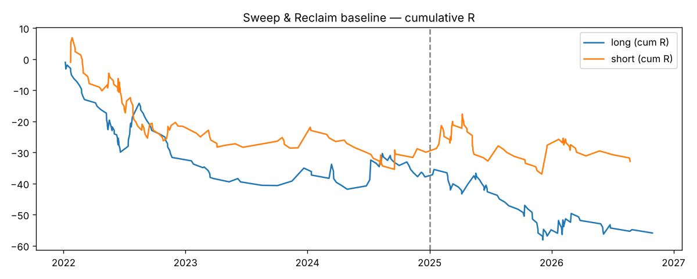

# Results: ETH Sweep & Reclaim on real Binance data

**Verdict: no edge.** The setup lost money on both sides, in every year from 2022 to 2026, before and after costs.
The modelled liquidation levels did no better than random levels at the same distance from price.
None of the filters from the trade plan (funding ≤ 0, 15m or 1h close, weekend only) made it reliably positive.

* Data: Binance ETHUSDT perpetual, 5m bars with 5m open interest and funding. 2022-01-01 to 2026-11-13 23:55 UTC, 512,064 bars, no gaps.
* In-sample (IS) 2022–2024 is used to pick parameters. Out-of-sample (OOS) runs from 2025-01-01 to 2026-11-13.
* Costs: 0.05% taker fee plus 0.02% slippage per side, about 0.13R per trade.
* Files: `docs/report.json`, `docs/robustness.csv`, `docs/grid_is.csv`, `docs/trades_baseline.csv`, `docs/equity_baseline.png`.

## 1. Baseline (README default rules, full sample)

| side | trades | per year | hit rate | avg R | profit factor | t-stat | at 1% risk/trade |
|---|---|---|---|---|---|---|---|
| long | 181 | 38 | 22.7% | **−0.31** | 0.63 | −2.69 | −44% |
| short | 176 | 38 | 25.6% | **−0.19** | 0.77 | −1.35 | −30% |
| both | 357 | 74 | 24.1% | **−0.25** | 0.70 | −2.78 | −61%, max drawdown 64% |

* **Every year was negative** (both sides together): 2022 −0.39R, 2023 −0.31R, 2024 −0.07R, 2025 −0.17R, 2026 −0.16R.
* **By exit:** 262 trades stopped out (−1.12R), 57 hit target (+2.93R), 38 hit the 24h time stop (+0.96R).
* **Before costs** the average is still −0.12R, so cheaper execution doesn't fix it.
* **Random-level control** (same rules, levels placed at random distances drawn from the real clusters' distances): long −0.24R, short −0.10R.
  The real map was *worse* than random levels. The liquidation map adds no information about where reversals happen.

## 2. Parameter search on IS, judged on OOS

There were 162 IS configurations (cluster size, reclaim window, OI drop, target R). Only **6.8% had a positive average R** in-sample.

| side | best IS config | IS | OOS | OOS vs 30 random-level seeds |
|---|---|---|---|---|
| long | cluster ≥ 10%, reclaim ≤ 1h, OI −1%, 1.5R | +0.17R (n 40, t 0.74) | **−0.76R** (n 12) | worse than 97% of seeds |
| short | cluster ≥ 3%, reclaim ≤ 30m, OI −1%, 1.5R | −0.13R (n 80) | +0.20R (n 30, t 0.49) | inside the random range (p90 +0.25R) |

The best long setup failed out-of-sample. The best short setup was negative in-sample, so its OOS result is noise.

## 3. Filters from the trade plan (default long, IS → OOS)

| variant | IS avg R (n) | OOS avg R (n) | comment |
|---|---|---|---|
| as is (reclaim on a 5m close) | −0.34 (112) | −0.27 (70) | random-level control is −0.29 |
| funding ≤ 0 | −0.34 (27) | −0.06 (18) | few trades, no IS improvement |
| funding below the neutral 0.01% | −0.30 (66) | −0.23 (62) | |
| reclaim confirmed on a 15m close | −0.23 (104) | −0.18 (63) | |
| reclaim confirmed on a 1h close | −0.17 (98) | +0.01 (57) | best variant, but by year −0.19 / −0.18 / −0.14 / −0.17 / +0.52 (2026, 15 trades) |
| zero fees and slippage | −0.23 (112) | −0.16 (70) | no gross edge |
| fixed 1R / 1.5R / 2R target | −0.26 / −0.31 / −0.36 | −0.26 / −0.31 / −0.23 | worse than the map target |

**Weekend vs weekday:** weekend trades were less bad over the full sample (−0.02R on 48 trades vs −0.28R on 309).
This doesn't hold up: in OOS, weekend longs made +0.05R (14 trades) while weekend shorts lost −0.83R (10 trades).

The short side behaves the same way. All variants are in `docs/robustness.csv`.

## 4. Data checks done before trusting the numbers
* **OI timing:** the OI price implied by Binance's metrics matches the bar's own close (1.3 bp) better than its open (2.5 bp) or the next close (9.4 bp).
  So OI stamped *t* is known at bar *t*'s close, and the backtest has no look-ahead.
* **Removed 215 bars with OI = 0** and 12 flip-flop glitch bars (mostly 2026-10-15). These wiped the modelled book and faked "OI dropped".
  No trades fall in the remaining glitch window.
* **No same-bar stop/target ambiguity** (0 cases), so the stop-first assumption doesn't bias the result.
* **Map sanity check:** at the last bar (2026-11-13, close $1,929) the model puts the strongest long cluster at $1,852 and the strongest short cluster at $1,991.
  That matches the public heatmaps ($1,975–1,990 shorts) and the next day's move through $1,850.
  The map is plausible. It just doesn't predict reversals.

## 5. What to take from this
1. **Don't trade "price sweeps a liquidation cluster, then reclaims it" as a standalone rule on ETH.**
   On 357 trades over five years it lost about a quarter of the risk on every trade.
   Its hit rate was about 24%. With winners at about +2.9R and losers at about −1.1R, break-even needs about 28%.
2. **Liquidation heatmaps show where price may travel, not where it will turn.**
   As entry levels they did no better than random levels at the same distance.
   Use them for context (targets, where stops are crowded), not as the trigger.
3. **If you still take the trade by hand, wait for a 1h close back above the level and keep size small.**
   It is the only variant that improved both in-sample and out-of-sample, but it is at best break-even.
4. **Untested here:** the "no reclaim, then short the retest" continuation scenario from the same plan, and real exchange liquidation feeds instead of a modelled map.
