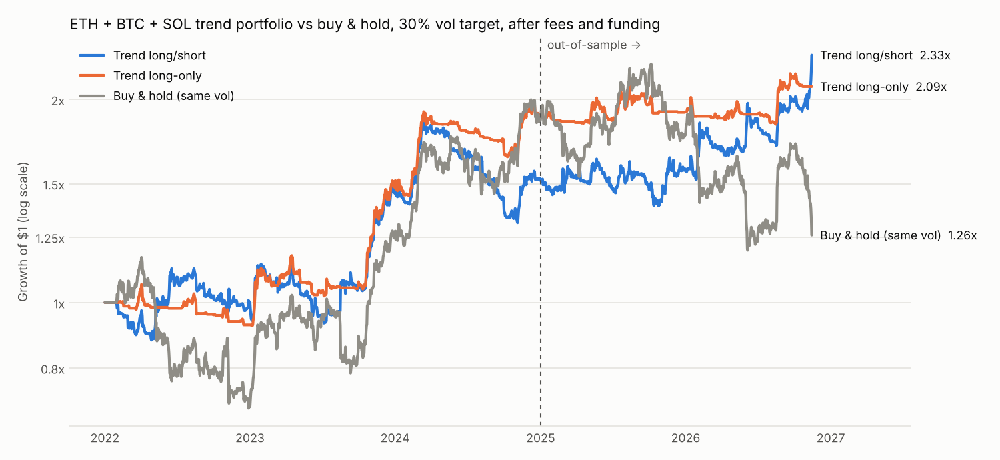

# What may work: multi-week trend on ETH, BTC and SOL

After sweep & reclaim failed ([RESULTS.md](RESULTS.md)), I tested ideas with a stated reason and fixed parameters.
Rules: discovery on 2022–2024, judged on 2025-01-01 → 2026-11-14, then checked on a coin never used for design (SOL).
Costs: 0.07% per side on every position change, plus perp funding paid or received daily.

## 1. Short-term liquidation and positioning signals: no edge

Event studies on 5m data: what happens 1h / 4h / 12h / 24h after an event, with a fixed hold and no stops (`src/research.py`, `docs/research/`).

| event (1h move ≥ 3σ, 1h OI change ≥ 2%) | idea | result |
|---|---|---|
| sharp drop + OI falls (long flush) | forced selling reverts | **no**: ETH keeps falling (−28 bp IS / −46 bp OOS at 4h, net) |
| sharp rise + OI falls (short squeeze) | forced buying reverts | no, mixed signs |
| sharp drop + OI rises (new shorts) | continuation | opposite: it bounces at 4h on ETH and BTC, but only at one threshold, t < 1, fails on SOL OOS. Noise |
| sharp rise + OI rises (new longs) | continuation | ETH IS positive (+56 bp at 12h), but fails on SOL and BTC OOS |
| funding in the top or bottom 5% | crowded side unwinds | no |
| sweep & reclaim taken only with the 28-day trend | trend filter | less bad IS (≈0R), −0.33R OOS. No |

A 0.14% round trip costs about as much as an average 1-hour ETH move. Hour-scale signals would need an edge they don't have.

## 2. Multi-week trend (time-series momentum): works on all three coins

**Rule (per coin, once a day at 00:00 UTC):**
1. Signal = average of sign(14-day return), sign(28-day return), sign(56-day return). The values are −1, −⅓, +⅓, +1.
2. Size = signal × 30% ÷ the coin's 30-day realised volatility, capped at 2×.
3. Long-only version: negative signals → flat.
4. Portfolio = equal thirds of ETH, BTC and SOL.

There is no optimisation. 14/28/56 days are the textbook horizons, averaged so no single lookback gets picked.



| 3-coin portfolio, 30% vol target | Sharpe | IS | OOS | CAGR | max DD | 2022 | 2023 | 2024 | 2025 | 2026 |
|---|---|---|---|---|---|---|---|---|---|---|
| **trend long/short** | **0.88** | 0.75 | 1.09 | 19% | **29%** | 0% | +45% | +5% | +3% | +47% |
| **trend long-only** | **1.08** | 1.40 | 0.45 | 16% | **15%** | −7% | +60% | +28% | +1% | +9% |
| buy & hold, same vol | 0.31 | 0.83 | −0.49 | 5% | 47% | −30% | +78% | +49% | −5% | −29% |

### Why I believe it more than the earlier results
* **Every coin, both periods.** Long/short Sharpe was 0.63–0.92 on ETH, BTC and SOL at each of the 00:00 / 08:00 / 16:00 UTC rebalance times. It was positive both in-sample and out-of-sample in all 9 cases.
* **SOL was never used to design anything** and still came out at 0.6–0.7.
* **Double costs** (0.14% per side): still 0.56–0.93 per coin.
* **Neighbouring lookbacks** (10–70 days) are mostly positive on ETH. On BTC, out-of-sample is weaker except at 14 days.
* **Not just the recent crash.** Out-of-sample up to 2026-09-01, before the Oct–Nov selloff, the Sharpe was 0.75 (long/short) and 0.52 (long-only); buy & hold was −0.11.
* **The academic literature agrees.** Time-series momentum at 1–8 weeks is one of the most replicated effects in crypto and futures generally.

### Weaknesses
* **Returns come in bursts.** Remove the 10 best days and the Sharpe falls to 0.34–0.48. Skipping signals by discretion would likely miss exactly those days.
* **The sample is short.** Five years with a Sharpe of about 0.9 gives a t-stat of about 2. Expect 0.4–0.8 live, not 1.0.
* **It earns mostly by stepping aside in bear legs** and by being short in crashes. In choppy years (2024–25) it makes 1–5%. Long-only lags buy & hold in strong bull years.
* **Slow by design.** It is late at turns: it only goes long well after a bottom.

## 3. Today's signal (closes up to 2026-11-14)

| coin | 14d / 28d / 56d return | signal | long/short size | long-only | 14d / 28d / 56d components flip to long on a daily close above |
|---|---|---|---|---|---|
| ETH | −22% / −26% / −33% | −1.00 | **−0.54×** | flat | 2,274 / 2,409 / 2,644 |
| BTC | −17% / −21% / −21% | −1.00 | **−0.71×** | flat | 78,313 / 82,078 / 81,144 |
| SOL | −26% / −32% / −37% | −1.00 | **−0.56×** | flat | 94.5 / 104.1 / 111.1 |

The flip levels roll forward each day (each is the close from that many days ago). Regenerate them daily:
```bash
for s in ETHUSDT BTCUSDT SOLUSDT; do python -m src.download --symbol $s; done
python -m src.trend_signal --target-vol 0.3
```
